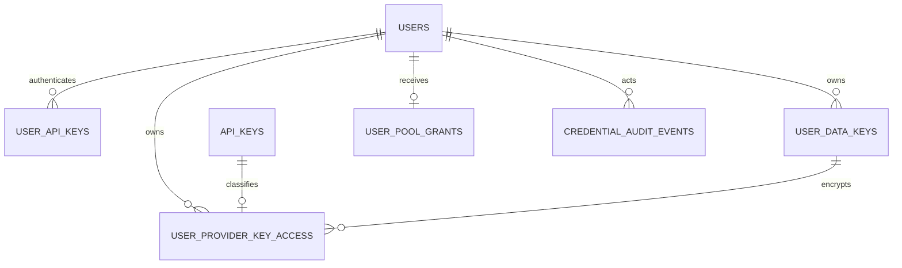

# RFC: User-owned provider keys and credential isolation

**Status:** Proposed design — not implemented or deployed.  
**Date:** 2026-11-01  
**Scope:** This FreeLLMAPI fork, SQLite and Turso/libSQL.  
**Related:** [Current personal keys](02-user-api-keys.md), [roles and invitations](01-roles-and-invite-registration.md), [Turso deployment](../deployment/03-turso.md).

The words **MUST**, **MUST NOT** and **SHOULD** describe requirements for the future implementation. They do not describe guarantees already provided by the running application.

## 1. Problem and current state

Several users can authenticate today, but their inference requests share the instance's provider pool. A personal gateway key identifies a user; it does not currently restrict the provider credentials, analytics, cache or fallback chain used for that request.

| Credential | Existing storage | Purpose | Gap |
| --- | --- | --- | --- |
| Dashboard password | `users.password_hash` | Account login | Account lifecycle and authorization need a multi-user review. |
| Dashboard session | Hashed token in `sessions`, linked to `users` | Dashboard/API management | A session is not an inference credential. |
| Personal gateway key, `sk-flm-…` | SHA-256 hash in `user_api_keys`, linked by `user_id` | Authenticate `/v1` and compatible inference surfaces | Owner context is not yet enforced through routing; stored RPM is currently inert. |
| Provider key, such as a Groq or Gemini key | AES-256-GCM ciphertext in `api_keys`, with `iv` and `auth_tag` | Authenticate outbound provider calls | No user ownership today. |
| Unified/client-profile key | Existing instance-level mechanisms | Compatibility with upstream installations | No reliable individual-user ownership; must not implicitly unlock private credentials. |

Sources: [custom migration](../../../server/src/db/migrations/20261031_155642_custom_user_roles_and_keys.ts), [personal key service](../../../server/src/services/user-keys.ts), [provider schema](../../../server/src/db/migrations/20260101_000000_legacy_baseline.ts), [crypto](../../../server/src/lib/crypto.ts), [credential resolution](../../../server/src/lib/system-prompt.ts).

## 2. Decisions

1. **Use one application database with explicit ownership.** Every person gets a logically isolated credential space. A separate physical database per person is outside this design. The FreeLLMAPI database remains separate from unrelated projects.
2. **Retain existing `api_keys.id` values.** Existing models, quotas, cooldowns and request records refer to those IDs. Store ownership and encryption metadata in dedicated new tables; add one format discriminator to `api_keys` through a new migration.
3. **Private by default.** A user's provider key belongs only to that user. It is not added to the shared pool. Sharing private keys or transferring ownership is outside version 1.
4. **Separate authentication from outbound credentials.** Personal gateway tokens remain hash-only. Provider secrets use authenticated, reversible encryption because the server must send them to the provider.
5. **Use envelope encryption for private provider secrets.** Each user has a versioned data-encryption key (DEK); the DEK is wrapped by a server-side key-encryption key (KEK). The initial KEK is the existing `ENCRYPTION_KEY`.
6. **Preserve instance behavior explicitly.** Existing provider rows remain instance-owned and encrypted with their existing format. Unified/client-profile credentials can use only the instance pool. A user can use that pool only when explicitly granted access.

The application server is the enforcement boundary. SQLite/libSQL does not provide the PostgreSQL-style row-level security assumed by some multi-tenant designs. A table, view or opaque ID alone is not an access-control boundary.

## 3. Security requirements

- **SEC-001:** Derive the acting user from a validated server-side session or personal token. Never trust `userId`, owner IDs, roles or pool names supplied in a request body/header/query.
- **SEC-002:** Every secret read, metadata lookup, mutation, test call and export MUST enforce ownership before accessing the credential.
- **SEC-003:** The candidate set for routing and every retry/fallback MUST remain within the caller's authorized credential scope.
- **SEC-004:** Private provider secrets MUST NOT be returned by list, detail, update, admin, export or support endpoints, including to their owner after submission.
- **SEC-005:** Provider secrets, DEKs, KEKs, bearer tokens and secret-bearing upstream errors MUST NOT reach logs, tracing, analytics or audit payloads.
- **SEC-006:** Revocation MUST reject subsequent authentication/dispatch decisions. Already-sent provider requests cannot be recalled.
- **SEC-007:** Failure to establish tenant context, ownership or decryption validity MUST fail closed. No implicit switch to another user's key or the shared pool is allowed.
- **SEC-008:** Existing single-user deployments and public protocol endpoints MUST retain their compatibility.
- **SEC-009:** No Turso token or encryption material may be shipped to the browser, mobile app or inference client.
- **SEC-010:** Tenant isolation tests are a release gate; role checks alone are insufficient.

## 4. Trust boundaries and admin policy

| Actor | Allowed operations on private provider credentials |
| --- | --- |
| Owner with a dashboard session | Submit, list masked metadata, test, disable, replace and revoke their own credentials. |
| Owner presenting a personal gateway token | Request inference using authorized credentials; no credential-management API access. |
| Another member | No discovery, metadata, testing, use, mutation or export. |
| Application admin | Suspend users, revoke access and inspect narrowly defined operational metadata through audited admin operations. No plaintext reveal/export or inference impersonation endpoint. |
| Instance operator with server execution/secret-store access | Trusted: can potentially decrypt secrets while operating the backend. This is not a zero-knowledge service. |
| Database-only reader | Sees ciphertext, wrapped DEKs and limited metadata; cannot decrypt without a KEK. |

Application-admin operations MUST remain separate from owner operations. Passing `role=admin` MUST NOT automatically bypass the owner predicate of an ordinary `/api/user/*` endpoint. Any future support impersonation would require a separate design and explicit audit controls.

Masking, hash-only gateway tokens and encryption at rest address different threats. Envelope encryption does not protect users from a compromised backend process holding the KEK, nor does a wrapped DEK make database backups safe to publish.

## 5. Logical data model



### 5.1 Existing `users` and `user_api_keys`

Keep user IDs and existing gateway hashes. Do not copy gateway plaintext into the reserved `user_api_keys.encrypted_key` column; leave it unused. The cryptographically random 192-bit gateway secret already supports hash-based verification; it is not a human password and does not need password hashing.

Add expiry and explicit inference scopes to personal gateway keys in a new migration. Keep revocation. Validate scopes against a server-side allowlist. Persist/enforce per-user and per-token limits; simply returning `rpm_limit` from token validation is not enforcement.

Resolve an explicit request principal, for example:

```ts
type CredentialScope =
  | { kind: 'instance' }
  | { kind: 'user'; userId: number; gatewayKeyId?: number };
```

The principal additionally carries approved endpoint/model scopes and quota policy. It is created at the authentication boundary and passed explicitly to routing. Async-local request context may carry observability metadata; it MUST NOT be the only authorization check for background jobs.

### 5.2 Existing `api_keys`: encrypted payload and stable identity

Retain the existing `platform`, `label`, `encrypted_key`, `iv`, `auth_tag`, `enabled` and health fields. Add:

| Column | Contract |
| --- | --- |
| `secret_format TEXT NOT NULL DEFAULT 'legacy_v1'` | Allowed values: `legacy_v1`, `user_envelope_v1`. Existing rows receive `legacy_v1` without re-encryption. |

Only legacy-format rows without a private-ownership record are instance-pool candidates. Envelope rows require a complete, valid ownership record; missing metadata MUST make them unusable, not instance-owned. Conversely, a private-ownership record pointing at a legacy-format row is invalid and MUST be rejected.

The old cipher fields remain hex-encoded text for compatibility. For `user_envelope_v1`, they contain ciphertext under the user's DEK, a 12-byte IV and a 16-byte GCM tag. They MUST be resolved by the new credential service, not passed to the legacy `decrypt()` function.

### 5.3 New `user_provider_key_access`

| Column | Contract |
| --- | --- |
| `api_key_id INTEGER PRIMARY KEY` | FK to `api_keys.id`, `ON DELETE CASCADE`; one owner per private provider key. |
| `credential_uid TEXT NOT NULL UNIQUE` | Random UUID generated before encryption; immutable authenticated identity. |
| `endpoint_binding TEXT NOT NULL` | Canonical provider/destination identity authenticated by AAD; built-in adapters use a server-approved identity, custom endpoints use a validated normalized URL. |
| `owner_user_id INTEGER NOT NULL` | FK to `users.id`, `ON DELETE RESTRICT`; derived from the principal. |
| `data_key_id TEXT NOT NULL` | References the DEK belonging to this same owner. |
| `credential_state TEXT NOT NULL` | `active`, `disabled` or `revoked`; revocation is terminal for this credential. |
| `secret_version INTEGER NOT NULL` | Starts at 1; increments on secret replacement and binds the encryption context. |
| `expires_at_ms INTEGER NULL` | Optional operator-defined local expiry; not a claim about the provider's own expiry. |
| `revoked_at_ms INTEGER NULL` | Present for revoked credentials. |
| `created_at_ms`, `updated_at_ms INTEGER NOT NULL` | UTC epoch milliseconds. |

Require a composite FK `(data_key_id, owner_user_id)` to `user_data_keys(id, owner_user_id)` so another user's DEK cannot be referenced. Add indexes on `(owner_user_id, credential_state, api_key_id)` and `data_key_id`.

Create/update `api_keys` and its private metadata in the same transaction. User ID, credential UID, provider identity and destination binding are immutable. To change a provider, destination or owner, create a new credential and revoke the previous one. Label changes do not require secret re-encryption. Health/discovery/test requests must use the authenticated destination binding as well as inference requests.

The sidecar avoids rebuilding a heavily referenced upstream table just to add ownership. The new `secret_format` field still requires a new timestamped migration; existing migration files are never edited.

### 5.4 New `user_data_keys`

| Column | Contract |
| --- | --- |
| `id TEXT PRIMARY KEY` | Random UUID. |
| `owner_user_id INTEGER NOT NULL` | FK to `users.id`, `ON DELETE RESTRICT`. |
| `version INTEGER NOT NULL` | Monotonically increasing per user; unique with `owner_user_id`. |
| `kek_version TEXT NOT NULL` | Identifies an external KEK; never contains key material. |
| `wrapped_dek TEXT NULL` | Hex-encoded AES-GCM ciphertext of a random 32-byte DEK. NULL only after destruction. |
| `wrap_iv TEXT NULL`, `wrap_auth_tag TEXT NULL` | Fresh 12-byte IV and 16-byte authentication tag, hex-encoded. |
| `state TEXT NOT NULL` | `active`, `decrypt_only` or `destroyed`. |
| `created_at_ms INTEGER NOT NULL` | UTC epoch milliseconds. |

Require `UNIQUE(id, owner_user_id)`, `UNIQUE(owner_user_id, version)` and a partial unique index allowing at most one active DEK per user. CHECK constraints require wrapped material for usable states and no wrapped material for `destroyed`. Application validation additionally checks hex encoding and byte lengths.

Old DEKs remain `decrypt_only` until all referenced credentials have been migrated. A referenced DEK MUST NOT be destroyed. User deletion is an explicit service operation that revokes access, purges provider rows/ownership records, removes gateway/session records and then destroys/removes DEKs in dependency order. The database MUST reject an incomplete deletion.

### 5.5 New `user_pool_grants` and audit records

- `user_pool_grants`: one row per explicitly allowed user, with `enabled`, `granted_by`, `granted_at_ms` and `revoked_at_ms`. No row means no shared-pool access. Instance administrators manage the instance pool through explicit instance-scoped operations; their personal inference tokens do not bypass this policy.
- `credential_audit_events`: event UUID, actor ID/role, subject user ID, credential UID when applicable, action, outcome, timestamp and request ID. Deleted users/keys must not cascade-delete the audit trail; use nullable references with immutable non-secret identifiers where retention requires them.
- Audit retention starts at 90 days as an application policy, configurable with documented purge behavior. This is a design default, not a legal retention claim. Audit creation and security-sensitive mutation MUST be atomic; failure to record an audit event rejects a credential mutation.

Do not record secrets, ciphertext, DEKs, KEKs, complete headers, request bodies or provider response bodies in audit rows.

## 6. Encryption protocol

### Write a private provider key

1. Authenticate the dashboard session; resolve its user ID and validate the operation.
2. Validate the provider against the supported provider catalog and validate provider-specific secret size/format. Reject CR/LF and other invalid header characters. Custom endpoints additionally pass outbound URL/SSRF validation, including resolved IP ranges, redirects and DNS rebinding considerations. Reject credential-bearing URLs and never forward authorization to a different origin through a redirect. Bind the approved destination into AAD; do not send a credential to an arbitrary URL submitted alongside it.
3. Obtain or create the owner's active random 256-bit DEK. For concurrent creation, rely on the unique active-DEK constraint and retry the losing transaction safely.
4. Generate `credential_uid`, `secret_version=1` and a fresh random 96-bit IV.
5. Encrypt the submitted provider secret with AES-256-GCM and a 128-bit tag. Set authenticated additional data (AAD) before encryption.
6. In one transaction, insert the encrypted `api_keys` row with `secret_format='user_envelope_v1'`, its ownership row and a secret-free audit event.
7. Return masked metadata only. The input field is cleared; the server does not echo the submitted secret.

Re-check that the selected DEK is still active in the write transaction. If concurrent rotation changed it, retry with the new DEK and fresh encryption material. Replacements use an expected `secret_version` comparison to prevent lost updates; ownership checks, version checks and mutation must not be separated into an unsafe check-then-write sequence.

Use canonical UTF-8 JSON arrays for AAD so field boundaries are unambiguous:

```text
Provider secret AAD:
["freellmapi-provider-key",1,owner_user_id,credential_uid,platform,endpoint_binding,data_key_id,secret_version]

Wrapped DEK AAD:
["freellmapi-user-dek",1,owner_user_id,data_key_id,dek_version,kek_version]
```

All participants use the same field types and order. Never reuse an IV under the same encryption key. Replacement, rewrapping and rotation each generate fresh IVs. Define and monitor a conservative per-key encryption-volume limit before shipping; low current traffic does not justify omitting IV lifecycle management.

### Dispatch to a provider

Authorize the candidate, verify active/enabled/nonexpired state, load its owner-matched envelope, select the KEK by version, verify/unwrap the DEK and verify/decrypt the provider secret using exactly the stored AAD identity. Any tag, owner, format or version mismatch rejects the credential and emits a non-secret operational event.

Plaintext exists only for the outbound request, in the appropriate provider authentication header. Never place it in a URL. Do not retain it on request/response objects, persist it in jobs or cache it globally. JavaScript strings cannot be reliably zeroized; keep their lifetime short and clear byte buffers where practical. This is a limitation, not a guaranteed memory-erasure mechanism.

## 7. Ownership and inference isolation

Owner queries MUST include the authenticated user predicate in SQL:

```sql
SELECT k.id, k.platform, k.label, a.credential_state
FROM api_keys k
JOIN user_provider_key_access a ON a.api_key_id = k.id
WHERE a.owner_user_id = ? AND k.id = ?
  AND k.secret_format = 'user_envelope_v1';
```

Return the same 404 for missing and foreign-owned IDs. A management test endpoint first performs this owner lookup, then performs an outbound test; it MUST NOT leak foreign-key validity by testing before authorization.

Routing rules:

- A personal gateway token uses its owner's active private candidates. It may also use the instance pool only with an explicit active pool grant and explicit request policy allowing that pool.
- The unified key and client-profile keys use instance candidates only; never guess a user from email, IP, profile name or model name.
- A dashboard Playground request derives the same user scope from its session. Any server-side convenience path using the unified key MUST NOT silently substitute instance scope for the logged-in person.
- Named chains, explicit model selection, embedding/image/audio/search/decision routes, Anthropic/Gemini/Ollama compatibility and MCP tools enforce the same scope. Unauthorized explicit key/model references fail instead of expanding the candidate pool.
- Re-check ownership/state immediately before each new dispatch and each fallback attempt. A queued job persists only a non-secret principal reference and credential ID, then revalidates both when it runs.
- Shared provider quotas remain shared for a shared credential. User request limits are additional controls and cannot replace a provider's account-wide quota.

**Isolation extends beyond key selection.** Response caches, idempotency keys, sticky-route state, conversations, request traces, analytics and user-specific model listings MUST include a tenant scope. An identical prompt or idempotency string from two users MUST NOT share a private cached response or reveal another user's activity. Internal provider cooldowns may remain keyed by the stable credential ID, but user-facing views must be owner-filtered.

Revocation prevents new authorization decisions after its database transaction commits. Work authorized before that point, including an outbound request already being sent, may finish. Database state and an external provider request cannot be committed atomically; do not promise cancellation of already-authorized work.

## 8. Proposed API and UI contract

These endpoints are proposed, not currently available:

| Method/path | Authorization | Result |
| --- | --- | --- |
| `GET /api/user/provider-keys` | Owner session | Owner's masked metadata; paginated. |
| `POST /api/user/provider-keys` | Owner session | Submit a provider credential; no owner/pool fields accepted. |
| `POST /api/user/provider-keys/:id/test` | Owner session + ownership | Bounded provider test; sanitized status only. |
| `PATCH /api/user/provider-keys/:id` | Owner session + ownership | Label and enabled state; no ownership or provider transfer. |
| `POST /api/user/provider-keys/:id/replace` | Owner session + recent password verification | Atomically replace encrypted secret, increment version and invalidate relevant runtime state. |
| `DELETE /api/user/provider-keys/:id` | Owner session + ownership | Terminal local revocation; does not revoke the upstream provider-issued credential. |
| `GET /api/admin/users` | Admin session | Minimal user/role/account status metadata. |
| `POST /api/admin/users/:id/suspend` | Admin + recent password verification | Revoke sessions/gateway access and prevent new dispatch; audited. |
| `PUT /api/admin/users/:id/role` | Admin + recent password verification | Explicit role change; transactionally prevent removal/suspension of the last active admin. |
| `PUT /api/admin/users/:id/pool-grant` | Admin + recent password verification | Explicit instance-pool grant or revocation; audited. |

Gateway token management remains under `/api/user/keys`. Gateway tokens never authorize these dashboard management endpoints. With cookie-based sessions, enforce CSRF protection and secure cookie policy; bearer-session implementations still need strict CORS and XSS protections. No credential belongs in browser localStorage as saved provider configuration.

Invite registration always creates a member. Only the existing guarded first-run setup or an explicit authorized role operation creates an admin. Reject role/owner/encryption-metadata fields in ordinary registration and credential payloads to prevent mass assignment.

The member UI provides **My provider keys** and **My gateway keys** as separate pages. Mask provider credentials with a fixed-length placeholder, optionally a last-four suffix; never show a variable-length mask revealing secret length. The admin UI manages people, suspension, grants and the instance pool. Hiding a button is not authorization.

## 9. Integration boundaries and upstream compatibility

Implement new logic in dedicated services, middleware and routers, with narrow hooks into existing entry points. Suggested modules:

- `server/src/services/user-provider-keys.ts`: owner-scoped CRUD and lifecycle.
- `server/src/services/user-key-envelopes.ts`: AEAD, AAD, DEK wrapping and key-version resolution.
- `server/src/services/credential-access.ts`: principal-to-candidate authorization and dispatch-time revalidation.
- `server/src/services/credential-audit.ts`: structured audit writes.
- `server/src/middleware/credential-scope.ts`: session/token principal creation.
- Dedicated user/admin routers mounted by `server/src/custom/register.ts`; DTOs in `shared` and dedicated frontend pages.

Before implementation, inventory every query/decrypt/export of `api_keys` and every credential consumer. Classify it as instance, owner or explicitly authorized background work. Unscoped legacy code MUST exclude `user_envelope_v1` rows. Centralize decryption in the new resolver; do not patch only `/api/user/*` while leaving proxy, health, export or discovery paths unrestricted.

This inventory must cover key listing/testing/export, provider health and discovery, quota/cooldown selection, custom models bound by `models.key_id`, all inference protocols, backup/restore, encryption-key rotation and administrative jobs. Integration may require small changes in several upstream selectors; pretending that adding an owner column alone provides isolation is unacceptable.

## 10. Key rotation, revocation and deletion

- **Gateway token rotation:** mint a new random token, show it once, allow a bounded overlap if requested, then revoke the old token. Revoked/expired/unknown credentials have indistinguishable public authentication failures.
- **Provider secret replacement:** encrypt a new version with fresh IV/AAD; atomically update state and audit. Invalidate health/capability caches, invalidate the old version in queued work, and preserve actual provider-account quota obligations. A replacement MUST NOT reset unrelated shared-account usage budgets.
- **DEK rotation:** create a new active DEK and mark the old one decrypt-only atomically. New writes use the new DEK; a resumable job re-encrypts old credentials with new AAD and fresh IVs. Destroy the old key only after confirming zero references and addressing backup retention.
- **KEK rotation:** select KEKs through a versioned server-side keyring. The initial version resolves to `ENCRYPTION_KEY`; old versions are retained externally during migration. Rewrap DEKs with fresh IVs and updated wrap AAD, verify round trips and record progress without secret material. Old KEKs remain necessary for old backups until those backups expire or are re-encrypted.
- **Existing rotation script:** [rotate-encryption-key.ts](../../../server/src/scripts/rotate-encryption-key.ts) MUST be extended to handle formats/envelopes before this feature is enabled. It must never treat envelope ciphertext as legacy ciphertext. Coordinate legacy-row re-encryption and server configuration changes; directly replacing `ENCRYPTION_KEY` is not a rotation procedure.
- **Provider compromise:** local deletion is insufficient. The owner must also revoke/rotate the credential at the provider; already-issued upstream access remains valid until the provider revokes it.
- **User deletion:** suspend first, revoke sessions and gateway tokens, prevent scheduled work, purge private provider rows in dependency order and process retention obligations. Deleting a live DEK does not erase copies of it from older backups.

## 11. Logging, backup and incident response

Continue HTTPS/TLS verification for browser, Render-to-Turso and provider traffic. Never disable certificate validation; native libSQL in the slim Docker runtime needs the OS CA certificate store.

Turso authentication tokens and KEKs are server-side secrets. Use a database-scoped Turso credential, keep it out of Git/CI logs/frontend bundles, and rotate it independently of user/provider keys. One database connection credential grants backend access to many users' rows; tenant checks therefore remain mandatory in application code.

Update export policy before enabling private-key storage:

- Existing admin provider-key exports MUST exclude private rows, whether decrypted or encrypted.
- Existing dashboard SQL dumps currently discover most tables automatically. They MUST be reviewed and changed so a normal instance-config export cannot include private ciphertext, ownership/envelope rows, user activity or audit history accidentally.
- A full operator disaster-recovery backup may include these rows, but must be encrypted, access-restricted and clearly separate from a shareable configuration export. Wrap the backup under a distinct backup key where available; do not bundle that key or the KEK with the backup.
- Restore credentials, envelopes and their matching KEK versions together. Verify owner integrity and decryption before serving traffic. Restoring old state may resurrect revoked access: keep a separately protected revocation record or require credential/session revalidation before enabling a restored instance. A normal config restore MUST NOT overwrite account/session or private-user credential state.
- Keep encryption material outside Turso and separately protected from the database backup. Test recovery on an isolated database without sending production-provider requests.

On a suspected disclosure: suspend affected access, stop new dispatch, revoke/rotate upstream provider secrets, rotate relevant gateway/Turso/KEK credentials according to the affected boundary, preserve non-secret audit evidence, and check backup/cache/log exposure. Report the affected scope rather than assuming DEK separation contains a live-backend compromise.

## 12. Migration and rollout

1. Follow Spec Kit specify → plan → tasks → implement when implementation is requested. This RFC alone does not authorize a production migration.
2. Capture a consistent encrypted backup and matching key-version inventory. Test migrations on a copy with existing instance rows and provider-bound models.
3. Add a **new timestamped migration** for the new tables, indexes and `api_keys.secret_format`. Existing `api_keys` rows remain legacy instance credentials. Do not automatically assign old shared secrets to the first admin or duplicate them into each user's vault.
4. Add expiry/scope fields to gateway tokens through another new migration as needed. Initially disable new private-key writes with a feature flag while readers, routing, export filtering and authorization tests are completed.
5. Implement the scoped resolver and ownership checks across the integration inventory. Existing local single-user behavior uses explicit instance scope.
6. Implement crypto, audit, revocation, safe exports and secret-free observability. No private gateway/provider key can be used for another user's data even when the admin UI is not yet available.
7. Pilot with two disposable users on an isolated database. Verify negative cases and measured concurrent latency before enabling the feature on production.
8. Enable owner storage, then optional shared-pool grants and admin UI. Preserve existing accounts and hash-only gateway tokens.

After private credentials exist, rollback to an old binary is unsafe: it may list private rows as instance credentials or feed envelope ciphertext into the legacy decryptor. Keep the feature off and reject private dispatch during a controlled rollback. Use a forward fix or a verified compatible binary; never rely on an old schema reader to ignore new security metadata. Destructive `down` migrations must refuse to discard live private secrets.

Migration tests MUST preserve provider key IDs, dependent model bindings, quota/cooldown references, indexes, triggers and sequence behavior. Run up/down/up on empty and populated databases and against a disposable remote Turso database. Do not depend on unsupported Turso TEMP-table behavior.

## 13. Release acceptance criteria

| Scenario | Required result |
| --- | --- |
| User A saves a provider key | Only ciphertext is stored; A owns it; list/detail responses contain no recoverable secret. |
| User B guesses A's key ID | List/detail/test/update/revoke return no information or side effect; foreign ID behaves like a missing ID. |
| Admin calls the ordinary owner endpoint for A's ID | No ownership bypass. Explicit audited admin suspension remains possible. |
| A requests fallback after an upstream failure | Only A's permitted candidates and explicitly granted instance candidates are considered. |
| B repeats A's prompt/idempotency key | No private cache, conversation, trace or result reuse. |
| Any supported inference protocol or queued job uses A's token | The same principal scope and dispatch checks apply. |
| Ciphertext, IV, tag, owner, UID, provider, endpoint binding, DEK reference or version is altered | Decryption/authorization fails; no permissive fallback. |
| A private ownership row is missing or corrupt | Envelope row is unusable and never becomes an instance candidate. |
| SQL constraints receive another user's DEK reference | Write is rejected; no partial credential or audit state remains. |
| Gateway token/provider credential/user is revoked or suspended | New dispatch is denied; delayed jobs cannot reuse stale authorization. |
| Provider test returns a secret-bearing error | No secret in response, logs, audit, metrics or tracing. |
| An admin exports ordinary instance configuration | No private keys, envelopes or private user activity are included. |
| KEK/DEK rotation fails midway | Job resumes safely; existing valid ciphertext remains recoverable with retained key versions. |
| Old backup is restored | Revocation/session replay risks are handled before access is enabled; isolated decrypt checks pass. |
| Current SQLite install upgrades | Existing instance keys and `/v1/*`, `/livez`, `/readyz`, `/api/ping` remain compatible. |
| Render restarts | Ownership, key versions, revocation and account state persist without reliance on local files. |

Use both database integration tests and HTTP/protocol-level tests with two users; a mocked owner filter alone cannot prove isolation. Include concurrent creation, replacement, revocation and quota tests, including rejection of new authorization decisions after revocation commits. Track p95 request latency and blocked-event-loop duration on Turso. Its current synchronous driver requires bounded background batches and explicit yielding; no startup-wide cached-catalog replay on remote storage. Choose a measured workload/SLO before production rollout rather than inventing a throughput guarantee here.

## 14. References and design limits

These references inform the design; they are not a claim of certification or completed compliance:

- [OWASP Secrets Management Cheat Sheet](https://cheatsheetseries.owasp.org/cheatsheets/Secrets_Management_Cheat_Sheet.html): secret lifecycle, controlled access and operational handling.
- [OWASP Authorization Cheat Sheet](https://cheatsheetseries.owasp.org/cheatsheets/Authorization_Cheat_Sheet.html): least privilege, default denial and authorization on each operation.
- [NIST SP 800-38D](https://csrc.nist.gov/pubs/sp/800/38/d/final): authenticated encryption using GCM and IV requirements. Track subsequent revisions when implementing the crypto module.

Future separate physical databases, team/workspace ownership, shared private credentials, external KMS/HSM integration, user-held decryption keys and billing are outside version 1. They require their own threat model and migration plan; the current proposal provides application-enforced user isolation under a trusted backend operator.
